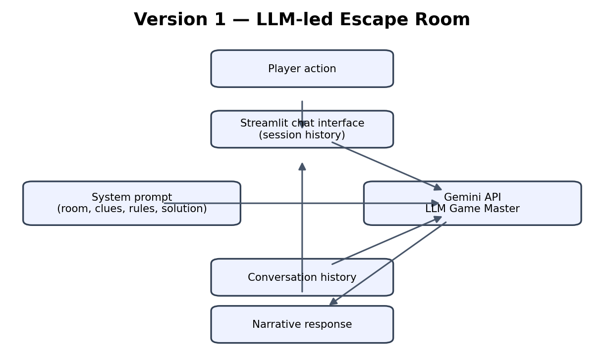
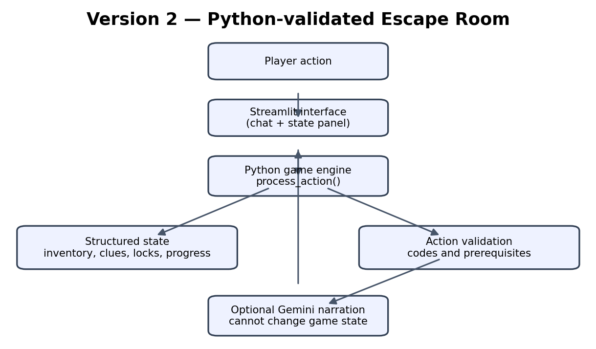

# AI-Powered Escape Room — Project Report

**Student:** Harshil Poshiya  
**Course:** [Enter the official course title]  
**Submission date:** 15 November 2026

## 1. Introduction and objective

This project develops an interactive escape-room application in which a player investigates a locked library, discovers clues, collects an item and attempts to escape. Two implementations demonstrate different ways to combine a Large Language Model (LLM) with application logic: Version 1 uses Gemini as the Game Master, while Version 2 uses Python as the authority for game state and puzzle validation.

The application uses Python and Streamlit. Gemini is accessed through the `google-genai` package and credentials are loaded locally using `python-dotenv`.

## 2. Game scenario and puzzle sequence

The room contains a wooden desk and notebook, a bookshelf with four unusual books, a painting, a locked drawer and a keypad-secured exit.

1. Examine the bookshelf to discover the drawer combination **2741**.
2. Enter 2741 to open the drawer.
3. Collect the brass key from the drawer.
4. Examine the painting to discover the year **1936**.
5. Use the brass key and enter 1936 at the exit to escape.

The notebook provides the hint: “The year above the entrance is the final number.”

## 3. Version 1 — LLM-led gameplay

Version 1 is implemented in `v1/app.py`. The Streamlit interface stores the conversation in `st.session_state.messages`. On each player turn, the application sends the conversation history, together with a system instruction defining the room, clues, solution and rules, to the Gemini model. Gemini generates the Game Master's response.

This approach supports flexible natural-language interaction and is relatively simple to implement. However, game state is inferred from the conversation and the model's compliance with the system prompt. Consequently, the model may forget a prior action, misinterpret an action or narrate an incorrect state transition. The application does not independently enforce all puzzle conditions in Python.

### Version 1 architecture

Player → Streamlit chat interface → conversation history + system prompt → Gemini Game Master → generated response → Streamlit chat interface.



## 4. Version 2 — Python-validated gameplay

Version 2 is implemented in `v2/app.py`, with the rules in `v2/game_engine.py`. The game engine stores structured state, including discovered clues, drawer status, key possession, inventory, door status, escape status and code-attempt count.

The interface passes each player action to `process_action()`. Python checks the action against the game rules and updates state only when the required conditions are satisfied. For example, the key cannot be collected before the drawer is open, and the exit cannot be unlocked without the key and the painting clue.

Gemini narration is optional and disabled by default. If enabled, Gemini only rewrites an already validated event. If the API call fails, the original Python response is used. Therefore, Gemini does not control inventory or puzzle completion in Version 2.

### Version 2 architecture

Player → Streamlit interface → Python action processing → structured game state and validation → validated response → optional Gemini narration → interface.



## 5. Version comparison

| Aspect | Version 1 | Version 2 |
|---|---|---|
| Main game logic | Gemini system prompt and conversation history | Python game engine |
| State storage | Chat history | Structured Python dictionary |
| Puzzle validation | Model follows prompt instructions | Deterministic Python checks |
| Gemini dependency | Required for game responses | Optional for narration |
| Failure behaviour | Shows a connection error if Gemini fails | Game remains playable without Gemini |
| Main advantage | Flexible conversation | More predictable state transitions |

## 6. Testing

The automated test suite is in `tests/test_game_engine.py`. The following command was run from the project root:

```powershell
py -m unittest discover -s tests -v
```

**Observed result during package preparation: 8 tests passed.**

The tests cover:
- Rejection of an incorrect drawer code.
- Rejection of key collection before the drawer opens.
- Rejection of drawer code entry before the bookshelf clue is discovered.
- No state change when a player claims administrator privileges and requests an unlock.
- Rejection of escape without the brass key.
- Successful completion of the full puzzle sequence.
- Rejection of exit code entry before the painting clue is discovered.
- Rejection of an incorrect exit code.

The Python source files `v1/app.py`, `v2/app.py`, `v2/game_engine.py` and `tests/test_game_engine.py` were also syntax-compiled successfully during package preparation. This does not replace running the Streamlit applications on the student's own computer.

## 7. Issues encountered and improvements

During the development conversation, Version 1 returned a Gemini API error stating that `gemini-2.5-flash` was no longer available to new users and recommending a newer model identifier. A 504 deadline timeout was also observed. The supplied `.env` contained `gemini-3.5-flash-lite`, which overrides the model default in the source code. The delivered `.env.example` has therefore been set to `gemini-3.8-flash`, based on the model identifier recommended in the error message shown during development. Model availability can depend on the Google AI Studio project and should be checked there if the API returns another model error.

Version 1's request timeout was reduced from 45 seconds to 20 seconds so a failed request does not leave the player waiting as long. The error message was simplified to avoid displaying the full raw exception in the game interface.

Version 2 avoids this dependency during normal play because Gemini narration is off by default. Its Python game engine and tests can be used without an API key.

## 8. Limitations and future work

Version 1 relies on prompt-following and conversation context, so it cannot guarantee every game-state transition. Version 2 uses keyword and pattern matching, which means some unusual natural-language expressions may not be recognized. Future improvements could include a structured action classifier, additional rooms, difficulty levels, a hint system, a timer and persistent player profiles. Python should remain responsible for validating any state-changing action.

## 9. Conclusion

The project demonstrates a progression from an LLM-led conversational prototype to a more reliable application in which Python validates puzzle actions and owns the game state. Version 1 demonstrates the flexibility of LLM-based interaction. Version 2 demonstrates why important rules, inventory changes and completion conditions should be enforced by deterministic application code, with the LLM used only as an optional narration layer.

## References

1. Google AI for Developers, Gemini API documentation: https://ai.google.dev/gemini-api/docs
2. Streamlit documentation: https://docs.streamlit.io/
3. Python documentation: https://docs.python.org/3/
4. Python `unittest` documentation: https://docs.python.org/3/library/unittest.html
